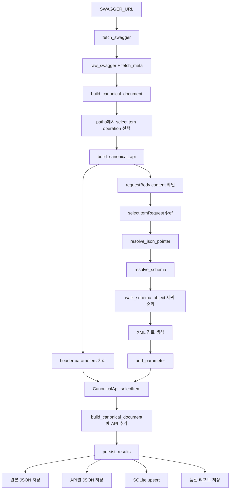
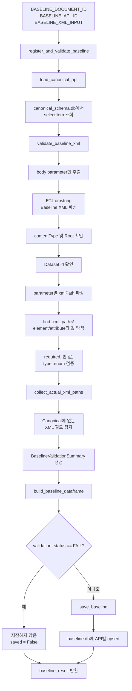
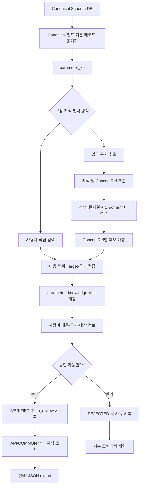
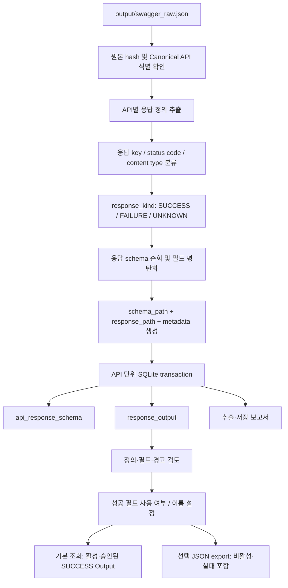

# Preprocessing Report

## 1. Swagger 기반 Canonical Schema 생성: `selectItem` 실행 흐름

이 항목은 [`preprocessing.ipynb`](./preprocessing.ipynb)의 1번 단계인 Swagger 기반 Canonical Schema 생성을 `selectItem` API를 예시로 정리한 것이다. 이 단계의 목적은 Swagger/OpenAPI의 operation과 request body schema를 API별로 동일한 형식의 Canonical Schema로 변환하고, 이후 XML Baseline 검증에서 재사용할 수 있도록 저장하는 것이다.

### 1.1 입력과 최종 산출물

- Swagger URL: `SWAGGER_URL`
- 문서 ID: `hmall-openapi-v1`
- 대상 operation: `POST /pd/pdb/selectItem.do`
- `operationId`: `selectItem`
- request content type: `application/xml`
- request body schema 참조: `#/components/schemas/selectItemRequest`

주요 산출물은 다음과 같다.

- 원본 Swagger: [`output/swagger_raw.json`](./output/swagger_raw.json)
- `selectItem`별 Canonical JSON: [`output/canonical_schema/hmall-openapi-v1/selectItem.json`](./output/canonical_schema/hmall-openapi-v1/selectItem.json)
- API별 Canonical Schema SQLite: [`output/canonical_schema.db`](./output/canonical_schema.db)
- 생성 결과 및 warning 리포트: [`output/canonical_schema_report.json`](./output/canonical_schema_report.json)

### 1.2 전체 실행 흐름



### 1.3 단계별 동작

#### 1) `fetch_swagger`: 원본 문서 조회

실행 셀은 먼저 Swagger URL을 호출한다.

```python
raw_swagger, fetch_meta = fetch_swagger(SWAGGER_URL)
```

`fetch_swagger`는 HTTP 요청을 보내 응답 JSON을 dictionary로 변환하고, HTTP status, content type, 응답 byte 수를 `fetch_meta`로 반환한다. 이 함수는 파일을 저장하지 않고 원본을 메모리로 반환한다.

실행 결과 리포트에는 다음 fetch 정보가 기록되어 있다.

```json
{
  "status": 200,
  "contentType": "application/json; charset=utf-8",
  "bytes": 237270
}
```

#### 2) `build_canonical_document`: 문서 전체 순회

```python
canonical_document = build_canonical_document(raw_swagger)
```

이 함수는 OpenAPI 버전과 `paths`를 확인한 뒤, 각 endpoint와 HTTP method를 순회한다. `selectItem`의 경우 다음 operation이 발견된다.

```text
POST /pd/pdb/selectItem.do
operationId = selectItem
```

문서 전체 순회는 `build_canonical_document`가 담당하고, operation 하나의 상세 변환은 `build_canonical_api`에 위임한다.

#### 3) `build_canonical_api`: `selectItem` API 변환

`operationId`가 있으므로 API ID는 그대로 `selectItem`이 된다. 이후 operation의 파라미터와 request body를 처리한다.

먼저 header parameter 두 개가 Canonical 경로로 변환된다.

```text
oauserId → $.headers.oauserId
oauseKey → $.headers.oauseKey
```

다음으로 request body의 content type과 schema를 확인한다.

```text
contentType = application/xml
schema     = #/components/schemas/selectItemRequest
```

body schema가 존재하므로 `walk_schema`가 `$.body`에서 시작된다.

#### 4) `$ref` 해석: `resolve_json_pointer`와 `resolve_schema`

request body의 시작점은 다음 `$ref`다.

```text
#/components/schemas/selectItemRequest
```

`resolve_json_pointer`는 Swagger 문서의 `components.schemas.selectItemRequest` 위치를 찾아 실제 schema 객체를 반환한다. `resolve_schema`는 이 과정을 감싸면서 `$ref`를 재귀적으로 해석하고, 필요한 경우 inline 속성을 병합한다.

해석된 schema의 주요 구조는 다음과 같다.

```text
Root
└─ Dataset (id = dsCond)
   └─ rows
      └─ row
         ├─ slitmCd
         ├─ itemCsfDCd
         └─ venCd
```

#### 5) `walk_schema`: request body 재귀 순회

`walk_schema`는 object를 만나면 `properties`를 따라 내부로 내려간다. object 자체는 parameter로 저장하지 않고, 실제 leaf field에 도달했을 때 `add_parameter`를 호출한다.

JSONPath는 다음처럼 생성된다.

```text
$.body.data1.id
$.body.data1.data2.data3.slitmCd
$.body.data1.data2.data3.itemCsfDCd
$.body.data1.data2.data3.venCd
```

동시에 XML metadata를 이용해 XMLPath도 만든다.

```text
/Root/Dataset[@id="dsCond"]/@id
/Root/Dataset[@id="dsCond"]/rows/row/slitmCd
/Root/Dataset[@id="dsCond"]/rows/row/itemCsfDCd
/Root/Dataset[@id="dsCond"]/rows/row/venCd
```

여기서 `Dataset[@id="dsCond"]`는 `get_xml_segment`가 생성하고, `@id`, `slitmCd` 같은 개별 segment 추가는 `append_xml_path`가 담당한다.

#### 6) `add_parameter`: Canonical parameter 생성

`add_parameter`는 leaf schema 하나를 `CanonicalParameter`로 변환해 목록에 추가한다. `selectItem`의 body field에는 다음 정보가 함께 저장된다.

- JSONPath: `path`
- 위치: `location = body`
- 필드명: `name`
- 정규화된 타입: `type = string`
- 원본 참조: `sourceRef = #/components/schemas/selectItemRequest`
- 설명과 예시: `description`, `example`
- XML 정보: `xmlName`, `xmlPath`, `xmlAttribute`

예를 들어 `slitmCd`는 다음과 같이 Canonical parameter가 된다.

```json
{
  "path": "$.body.data1.data2.data3.slitmCd",
  "location": "body",
  "name": "slitmCd",
  "type": "string",
  "description": "판매상품코드",
  "example": "판매상품코드(예:2015700001)",
  "sourceRef": "#/components/schemas/selectItemRequest",
  "xmlPath": "/Root/Dataset[@id=\"dsCond\"]/rows/row/slitmCd",
  "xmlAttribute": false
}
```

#### 7) `CanonicalApi`와 `CanonicalDocument` 완성

header 2개와 body 4개가 합쳐져 `selectItem` API에는 총 6개의 parameter가 들어간다.

```text
$.headers.oauserId
$.headers.oauseKey
$.body.data1.id
$.body.data1.data2.data3.slitmCd
$.body.data1.data2.data3.itemCsfDCd
$.body.data1.data2.data3.venCd
```

`build_canonical_api`는 이 목록과 API 메타데이터를 합쳐 `CanonicalApi`를 반환한다. 이후 `build_canonical_document`는 이를 전체 API 목록에 추가해 `CanonicalDocument`를 완성한다.

#### 8) `persist_results`: 최종 저장

```python
report = persist_results(
    raw_swagger,
    canonical_document,
    fetch_meta
)
```

마지막으로 `persist_results`가 다음 작업을 수행한다.

1. 원본 Swagger를 `swagger_raw.json`으로 저장
2. `selectItem.json`처럼 API별 Canonical JSON 저장
3. `api_canonical_schema` SQLite 테이블에 API별 JSON upsert
4. source hash, API 수, parameter 수, warning 수를 품질 리포트에 저장

이렇게 생성된 `selectItem` Canonical Schema는 이후 Baseline 등록 단계에서 SQLite로 조회된다. 이후 XML 검증은 `xmlPath`, `xmlAttribute`, `required`, `type` 등의 정보를 이용해 실제 Baseline XML과 Canonical Schema의 구조와 값을 비교한다.

## 2. Baseline 등록 및 검증: `selectItem` 실행 흐름

이 항목은 [`preprocessing.ipynb`](./preprocessing.ipynb)의 2번 단계인 Baseline 등록 및 검증을 `selectItem` API를 예시로 정리한 것이다. 1번 단계에서 생성한 Canonical Schema를 SQLite에서 조회하고, 실제 request XML body가 Canonical Schema의 XML 구조와 필드 정의에 맞는지 검증한 뒤, 검증을 통과한 Baseline을 `baseline.db`에 저장한다.

### 2.1 입력과 최종 산출물

- 문서 ID: `hmall-openapi-v1`
- 대상 API ID: `selectItem`
- Canonical Schema 입력: [`output/canonical_schema.db`](./output/canonical_schema.db)의 `api_canonical_schema` 테이블
- Baseline XML 입력: `BASELINE_XML_INPUT`
- request content type: `application/xml`

`selectItem`에 사용하는 Baseline XML은 다음과 같다.

```xml
<?xml version="1.0" encoding="UTF-8"?>
<Root>
    <Dataset id="dsCond">
        <rows>
            <row>
                <slitmCd>2015700001</slitmCd>
                <itemCsfDCd>40010202</itemCsfDCd>
                <venCd>003766</venCd>
            </row>
        </rows>
    </Dataset>
</Root>
```

이 XML은 `selectItem` Canonical Schema의 다음 body 경로와 매칭된다.

```text
/Root/Dataset[@id="dsCond"]/@id
/Root/Dataset[@id="dsCond"]/rows/row/slitmCd
/Root/Dataset[@id="dsCond"]/rows/row/itemCsfDCd
/Root/Dataset[@id="dsCond"]/rows/row/venCd
```

주요 산출물은 다음과 같다.

- 검증 결과 요약: `baseline_result['summary']`
- 필드별 검증 결과: `baseline_result['rows']`
- 검증 결과 DataFrame: `baseline_result['dataframe']`
- 저장 여부: `baseline_result['saved']`
- Baseline SQLite: [`output/baseline.db`](./output/baseline.db)의 `api_baseline` 테이블

### 2.2 전체 실행 흐름



### 2.3 단계별 동작

#### 1) 입력값 설정 및 실행

마지막 셀에서 문서 ID, API ID, XML body를 설정한다.

```python
BASELINE_DOCUMENT_ID = DOCUMENT_ID
BASELINE_API_ID = 'selectItem'
BASELINE_XML_INPUT = """<?xml version="1.0" encoding="UTF-8"?>
<Root>
    <Dataset id="dsCond">
        <rows>
            <row>
                <slitmCd>2015700001</slitmCd>
                <itemCsfDCd>40010202</itemCsfDCd>
                <venCd>003766</venCd>
            </row>
        </rows>
    </Dataset>
</Root>"""
```

이후 다음 함수를 실행한다.

```python
baseline_result = register_and_validate_baseline(
    document_id=BASELINE_DOCUMENT_ID,
    api_id=BASELINE_API_ID,
    baseline_xml=BASELINE_XML_INPUT,
)
```

여기서 입력하는 값은 HTTP header나 URL이 아니라 request body XML 전문이다. `selectItem`의 header parameter인 `oauserId`, `oauseKey`는 Canonical Schema에 포함되어 있지만, 현재 Baseline 검증 함수는 `location == 'body'`인 parameter만 검증한다.

#### 2) `load_canonical_api`: Canonical Schema 조회

```python
canonical_api = load_canonical_api(
    document_id='hmall-openapi-v1',
    api_id='selectItem',
)
```

`load_canonical_api`는 `canonical_schema.db`의 `api_canonical_schema` 테이블에서 `(document_id, api_id)`를 조건으로 `canonical_json`을 조회한다. `selectItem`에 대해 조회되는 body parameter는 다음 네 개다.

```text
$.body.data1.id                     → /Root/Dataset[@id="dsCond"]/@id
$.body.data1.data2.data3.slitmCd    → /Root/Dataset[@id="dsCond"]/rows/row/slitmCd
$.body.data1.data2.data3.itemCsfDCd → /Root/Dataset[@id="dsCond"]/rows/row/itemCsfDCd
$.body.data1.data2.data3.venCd      → /Root/Dataset[@id="dsCond"]/rows/row/venCd
```

이 단계에서 API를 찾지 못하거나 `canonical_json`이 올바른 JSON object가 아니면 검증 전에 예외가 발생한다.

#### 3) `validate_baseline_xml`: XML 기본 구조 확인

검증 함수는 먼저 Canonical API의 parameter 중 `location == 'body'`인 항목만 추출한다. 이후 다음 기본 검사를 수행한다.

1. XML body가 비어 있지 않은지 확인
2. `ET.fromstring`으로 XML 문법 확인
3. Canonical content type이 `application/xml`인지 확인
4. XML root가 Canonical Schema의 첫 XML 경로인 `Root`와 일치하는지 확인
5. XML에 존재하는 Dataset ID가 Canonical Schema에 정의되어 있는지 확인

`selectItem`에서는 다음 값이 서로 일치해야 한다.

```text
Canonical Dataset id: dsCond
Baseline Dataset id:  dsCond
```

#### 4) `parse_xml_path`와 `find_xml_path`: Canonical 경로 기반 값 탐색

각 Canonical parameter의 `xmlPath`를 segment 목록으로 나누고, Baseline XML에서 해당 경로를 찾는다. 예를 들어 `slitmCd`의 경로는 다음과 같이 해석된다.

```text
/Root/Dataset[@id="dsCond"]/rows/row/slitmCd
```

```text
Root
└─ Dataset[@id="dsCond"]
   └─ rows
      └─ row
         └─ slitmCd → 2015700001
```

`find_xml_path`의 반환 결과는 element와 attribute를 구분한다.

```python
# element 예시
{
    'kind': 'element',
    'element': <slitmCd>2015700001</slitmCd>,
    'value': '2015700001',
}

# attribute 예시
{
    'kind': 'attribute',
    'element': <Dataset id="dsCond">,
    'value': 'dsCond',
}
```

따라서 `selectItem`의 실제 추출값은 다음과 같다.

```text
id         = dsCond
slitmCd    = 2015700001
itemCsfDCd = 40010202
venCd      = 003766
```

#### 5) 필드별 검증

경로에서 값을 찾은 뒤 `validate_baseline_xml`은 각 필드에 대해 다음 항목을 확인한다.

- Canonical 경로가 XML에 존재하는지 확인
- required 필드가 누락되거나 빈 값인지 확인
- `integer`, `number` 타입인 경우 숫자 변환 가능 여부 확인
- enum 목록이 있는 경우 허용 값인지 확인
- 선택 필드가 비어 있는 경우 메시지만 기록

`selectItem`의 body field는 모두 `string` 타입이고 enum도 없으므로, 이 입력에서는 값의 존재 여부와 XML 경로 일치 여부가 핵심 검증 대상이다.

필드별 결과 row에는 다음 정보가 기록된다.

```text
path, xmlPath, name, expected_type, required,
expected_value, actual_value, xmlAttribute, status, message
```

#### 6) `collect_actual_xml_paths`: 미등록 XML 필드 확인

parameter별 검증이 끝나면 `collect_actual_xml_paths`가 Baseline XML의 leaf element와 attribute 경로를 모두 수집한다. Canonical Schema의 `xmlPath` 목록에 없는 실제 경로가 있으면 `UNKNOWN_FIELD`로 기록한다.

`selectItem`의 입력 XML은 다음 경로만 포함하므로, 모두 Canonical Schema와 일치한다.

```text
/Root/Dataset[@id="dsCond"]/@id
/Root/Dataset[@id="dsCond"]/rows/row/slitmCd
/Root/Dataset[@id="dsCond"]/rows/row/itemCsfDCd
/Root/Dataset[@id="dsCond"]/rows/row/venCd
```

#### 7) 검증 요약 생성

각 row의 상태를 집계하여 최종 상태를 결정한다.

```text
PASS                   : 오류 없음
PASS_WITH_REQUIRED_EMPTY: required 빈 값만 존재
FAIL                   : 구조, 누락, 타입, enum, unknown field 오류 존재
```

정상적인 `selectItem` 입력이라면 다음과 같은 결과가 된다.

```json
{
  "document_id": "hmall-openapi-v1",
  "api_id": "selectItem",
  "validation_status": "PASS",
  "total_fields": 4,
  "valid_count": 4,
  "required_empty_count": 0,
  "error_count": 0,
  "unknown_field_count": 0
}
```

#### 8) `build_baseline_dataframe`: 결과 표시

`build_baseline_dataframe`은 검증 row 목록을 pandas DataFrame으로 변환한다. Jupyter 환경에서는 `display(dataframe)`으로 표를 출력하고, `display`가 없는 환경에서는 문자열 표로 출력한다.

`baseline_result['dataframe']`을 통해 필드별 실제 값과 상태를 다시 확인할 수 있다.

#### 9) `save_baseline`: `baseline.db` 저장

검증 상태가 `FAIL`이 아니면 `save_baseline`이 `output/baseline.db`의 `api_baseline` 테이블에 Baseline을 저장한다.

저장 항목은 다음과 같다.

- `document_id`: `hmall-openapi-v1`
- `api_id`: `selectItem`
- `baseline_xml`: 입력 XML 전문
- `content_type`: `application/xml`
- `validation_status`: `PASS` 또는 `PASS_WITH_REQUIRED_EMPTY`
- `validation_result_json`: 전체 검증 결과
- `created_at`, `updated_at`: 저장 시각

`(document_id, api_id)`가 복합 기본키이므로 동일한 `selectItem` Baseline을 다시 실행하면 중복 row가 생성되지 않고 기존 row가 갱신된다. Canonical Schema 생성 단계의 `api_canonical_schema` 저장도 같은 방식의 upsert이므로, Canonical Schema를 재생성한 뒤 Baseline 검증을 다시 수행할 수 있다.

#### 10) `register_and_validate_baseline`: 전체 오케스트레이션

최상위 함수인 `register_and_validate_baseline`은 앞의 과정을 순서대로 연결한다.

```text
Canonical Schema 조회
→ XML 검증
→ DataFrame 변환 및 표시
→ FAIL이 아니면 baseline.db 저장
→ summary, rows, dataframe, saved 반환
```

따라서 `selectItem`의 XML이 Canonical Schema와 일치하면 `baseline_result['saved']`는 `True`가 되고, 구조 오류나 `UNKNOWN_FIELD`가 있으면 `False`가 되며 `baseline.db`에는 저장되지 않는다.

## 3. ParameterKB 생성·보강 및 승인 흐름

이 절은 [`preprocessing.ipynb`](./preprocessing.ipynb)의 3번 단계를 정리한다. 1번에서 만든 Canonical Schema를 기술적 기준 레코드로 복사하고, 업무 의미·별칭·값 해석·기본값·규칙 등의 보강 지식을 별도 저장한다. 보강 지식은 등록만으로 적용되지 않으며, 항목별 검토를 거쳐 `VERIFIED` 된 내용만 기본 조회에 포함된다.

### 3.1 입력과 저장 구조

- Canonical 입력: `output/canonical_schema.db`의 API별 Canonical Schema
- ParameterKB DB: `output/parameter_kb.db`
- 선택 입력: API/COMMON 지식의 직접 입력 또는 UTF-8 `.md`/`.txt` 업무 문서
- 선택 검색 인덱스: `output/parameter_vectors/`의 ChromaDB 벡터

DB는 역할에 따라 세 테이블을 사용한다.

| 테이블 | 역할 | 예시 |
| --- | --- | --- |
| `parameter_kb` | Canonical 필드, schema, 원본 경로 등 기술 기준 | `$.body.data1.data2.data3.slitmCd`, type `string` |
| `parameter_knowledge` | API/COMMON 구분, 지식 종류, 내용, 대상, 근거, 상태 | `selectItem`의 상품 코드에 대한 설명 보강 후보 |
| `kb_review` | 지식 항목의 승인·반려 이력 | 검토자, 결정, 사유, 검토 시각 |

### 3.2 전체 실행 흐름



### 3.3 단계별 동작과 예시

#### 1) Canonical 기본 레코드 동기화

3.2의 실행 셀은 Canonical DB를 읽어 파라미터별 기본 레코드를 KB에 반영한다. 같은 입력으로 재실행해도 이미 등록한 보강 지식과 검토 이력은 덮어쓰지 않는다. Canonical 필드 정의가 바뀌면 관련 API 지식은 재검증 대상으로 표시된다.

예를 들어 다음 Canonical 필드가 기본 레코드 후보가 된다.

```text
document_id = hmall-openapi-v1
api_id = selectItem
parameter_path = $.body.data1.data2.data3.slitmCd
type = string
description = 판매상품코드
```

#### 2) 직접 입력 또는 업무 문서에서 지식 후보 생성

직접 입력에서는 사용자가 `kind`를 선택하고 해당 종류에 필요한 payload를 넣는다. 예를 들어 `MEANING`에는 `role`과 `value`, `ALIAS`에는 `value`와 `alias_type`, `VALUE_MAPPING`에는 매핑 종류와 값·표현식이 필요하다. API 범위 지식은 `api_ids`와 정확한 Canonical Target(문서 ID, API ID, parameter path, role)을 지정한다.

다음은 판매상품코드에 의미와 자연어 별칭을 보강하는 개념 예시다.

```text
API: selectItem
Target: $.body.data1.data2.data3.slitmCd
MEANING: role=description, value="상품 조회에 사용하는 판매상품 식별 코드"
ALIAS: alias_type=NATURAL_LANGUAGE, value="상품코드"
상태: 검토 전 후보
```

위 예시는 데이터 구조를 설명하기 위한 것이며, 노트북 실행 셀의 실제 API 변수와 입력 모델을 따라 등록해야 한다. 후보 등록 시 대상 필드와 kind별 필수 항목, 값 형식 및 근거가 검증된다.

3.5의 문서 추출은 `.md` 또는 `.txt`의 원문 근거와 ConceptRef를 추출한다. COMMON 문서는 업무 공통 지식 후보만 만들고 Canonical 필드 검색을 생략한다. API 지정 문서는 각 API와 ConceptRef 조합별로 문자열 검색 및 선택적 Chroma 의미 검색을 실행하고, 검색 후보를 LLM에 전달해 Target을 제안한다. 검색·LLM 실패나 참조 누락은 보류 사유로 저장되며, 일부 참조만 해결된 경우 `PARTIAL`이다. 자동 매칭 결과도 승인 전에는 적용되지 않는다.

ChromaDB와 임베딩은 인덱스 동기화나 필드 후보 검색 스위치를 켰을 때만 초기화된다. 임베딩 호출에는 `.env`의 `OPENAI_API_KEY`와 `OPENAI_EMBEDDING_MODEL` 설정이 필요하다. 직접 입력, 기본 레코드 생성, 검토 및 조회는 LLM이나 임베딩 호출 없이 수행할 수 있다.

#### 3) 후보 검토 및 승인·반려

후보를 검토할 때는 지식 내용뿐 아니라 범위, 정확한 Target, 원문 근거와 검증 결과를 함께 확인한다. 미해결 API 참조, 필수 참조 누락, 충돌 또는 검증 오류가 있으면 승인할 수 없다. 수정이 필요하면 기존 payload를 덮어쓰지 않고 새 후보를 등록한다. 기존 지식을 명시적으로 대체하려면 `supersedes_id`로 연결하고, 새 항목이 승인된 뒤 이전 항목은 기본 조회에서 제외된다.

승인 가능한 후보는 `VERIFIED`, 반려한 후보는 `REJECTED`로 결정하고 해당 검토 결과를 `kb_review`에 남긴다. 문서에서 여러 API 후보가 만들어졌다면 성공한 API를 각각 확인할 수 있고, 실패·부분 성공 API는 해결 전까지 보류된다.

#### 4) 승인 지식 조회와 export

기본 조회는 API의 Canonical 기본 정보 및 해당 API의 승인 지식을 반환하고, 관련 COMMON 지식 후보는 별도 범주로 보여준다. COMMON 지식을 조회했다는 이유만으로 특정 API 필드에 자동 연결되지는 않는다. 실행값 선택, 규칙 적용, API와 COMMON 지식의 결합은 후속 단계의 책임이다.

3.8의 JSON export는 기본 레코드와 승인된 보강 지식을 API/COMMON 범위별로 파일화한다. 이 결과는 조회 가능한 지식의 전달용 산출물이며, 승인 전 후보가 실행 파라미터로 바뀌는 단계는 포함하지 않는다.

## 4. Response Outputs 추출 및 관리 흐름

이 절은 [`preprocessing.ipynb`](./preprocessing.ipynb)의 4번 단계를 정리한다. 저장된 Swagger의 응답 정의를 읽어 응답 종류별 schema와 필드 후보를 추출하고, `output/response_outputs.db`에 저장한다. 요청 파라미터를 다루는 1번 Canonical Schema와 달리 이 단계는 응답 필드 정의를 별도 구조로 관리한다. 실제 업무 API를 호출하거나 응답값을 실행 단계에 바인딩하지는 않는다.

### 4.1 입력과 주요 산출물

- 원본 기본 입력: `output/swagger_raw.json`
- 원본 식별: `document_id`, `api_id`, 응답 키, content type
- 저장소: `output/response_outputs.db`의 `api_response_schema`, `response_output` 테이블
- 보고서: `output/response_outputs_report.json`
- 선택 export: `output/response_outputs/<document_id>/<api_id>.json`

응답 필드마다 논리적인 `schema_path`와 응답 payload에서의 `response_path`를 보존한다. XML 응답의 경우 `response_path`에는 XML XPath가 들어간다. 실패 응답도 원래 response key로 구분해 저장하므로 성공 응답 정의와 뒤섞이지 않는다.

### 4.2 전체 실행 흐름



### 4.3 단계별 동작과 예시

#### 1) 동일한 Swagger 원본에서 추출

4.2는 기본적으로 1번에서 저장한 `output/swagger_raw.json`을 입력으로 사용한다. 메모리에 있는 원본을 사용할 경우에는 `raw_document=raw_swagger`를 명시하며, 파일 경로와 동시에 지정하지 않는다. Swagger 원본이 Canonical 생성에 사용된 원본과 다르면 먼저 1번 Canonical Schema를 같은 원본으로 갱신한다. 초기화 시 원본 hash와 Canonical API 식별이 확인되어 어느 명세에서 추출한 정의인지 추적할 수 있다.

기본 실행 예시는 전체 API를 대상으로 한다. 일부만 처리할 때는 `RESPONSE_API_IDS`에 API ID 목록을 둔다.

```python
response_outputs = ResponseOutputs(PROJECT_DIR)
RESPONSE_DOCUMENT_ID = DOCUMENT_ID
RESPONSE_API_IDS = None  # 전체 API
response_outputs_report = response_outputs.initialize_response_outputs(
    RESPONSE_DOCUMENT_ID, RESPONSE_API_IDS
)
```

#### 2) 응답 정의 분류 및 필드 평탄화

각 API의 response 항목을 response key, status code, content type 단위로 나누고 응답 종류를 분류한다. 예를 들어 `selectItem`의 HTTP 200 `application/xml` 응답과 `multiItem`의 `200_fail` 응답은 별개 정의로 저장된다. 성공 여부를 명확히 판별할 수 없는 정의는 `UNKNOWN`으로 남긴다.

schema를 순회해 중첩 응답 필드를 평탄화한다. 예를 들어 다음처럼 중첩된 필드가 있다면:

```text
data1 → data2 → data3 → slitmCd
```

논리 schema 경로는 `$.data1.data2.data3.slitmCd`와 같이 만들어진다. 실제 XML 경로는 XML 이름과 요소/속성 여부를 반영한 XPath로 별도 기록된다. 필드에는 생성 이름, type/format, 설명, 원본 metadata 및 검토 필요 여부도 연결된다.

추출 상태가 부분적이면 기존에 있던 필드를 무조건 제거하지 않고 재검토 대상으로 보존한다. 완전한 추출에서 사라진 정의나 필드는 비활성화된다. 저장은 API 단위 transaction이므로 한 API의 추출 실패를 다른 API의 저장 결과와 분리할 수 있다.

#### 3) 활성화 기본값과 사용자 설정 보존

새로 추출된 `SUCCESS` 필드는 처음에 `enabled=true`로 등록되고, `FAILURE` 또는 `UNKNOWN` 응답의 필드는 `enabled=false`로 등록된다. 기존 설정을 가진 필드를 같은 원본으로 다시 처리할 때에는 사용자가 정한 enabled 상태와 이름 변경을 보존한다. 스키마 변경이나 추출 미해결은 `review_required`로 표시되어 기본 조회에서 제외된다.

예를 들어 `multiItem` 성공 응답의 상품코드 필드를 다음 복합키로 관리할 수 있다.

```text
document_id = hmall-openapi-v1
api_id = multiItem
response_key = 200
content_type = application/xml
schema_path = $.data1.data2.data3.slitmCd
```

이 필드를 끄거나 사용자 표시 이름을 바꾸는 것은 설정 변경 셀의 `configure_response_output`이 처리한다. FAILURE/UNKNOWN 필드는 활성화할 수 없다. 추출 문제를 해결하지 않은 채 `confirm_review=True`로 검토 상태를 지울 수 없으므로 원본 또는 정의를 먼저 바로잡아야 한다.

#### 4) 정의·필드 확인과 조회 기준

4.3의 조회 셀은 `get_response_definitions`로 응답별 status, 종류, 추출 상태와 경고를 확인하고, `get_response_outputs(..., include_inactive=True, include_failures=True)`로 비활성 및 실패 필드를 포함한 전체 후보를 확인한다. 이때 주요 점검 항목은 다음과 같다.

- `response_key`, `status_code`, `response_kind`, `content_type`
- `schema_path`와 실제 `response_path`
- `enabled`, `is_active`, `review_required`
- `extraction_status` 및 추출 경고

기본 조회인 `get_response_outputs(document_id, api_id)`는 활성 상태이며 현재 성공 응답에 속하고, 사용 설정이 켜져 있으며 재검토가 필요 없는 필드만 반환한다. 따라서 추출 결과 전체와 실제 사용 가능한 Output 목록은 서로 다를 수 있다.

#### 5) JSON export와 처리 경계

선택 export는 API별 JSON 파일에 응답 정의와 Output 필드를 기록한다. export는 비활성·실패 필드도 포함하며 원본 hash와 조회 조건을 함께 보존해 이후 검토에 활용할 수 있다.

이 단계의 산출물은 응답 구조와 사용 가능한 Output 후보의 목록이다. 런타임 API 호출, 실제 응답 body에서 값 추출, 앞 단계의 파라미터로 연결하는 Step binding은 여기서 수행하지 않는다.
