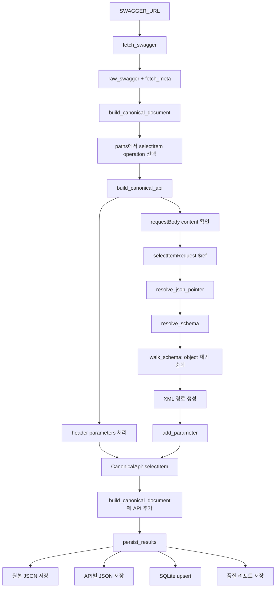
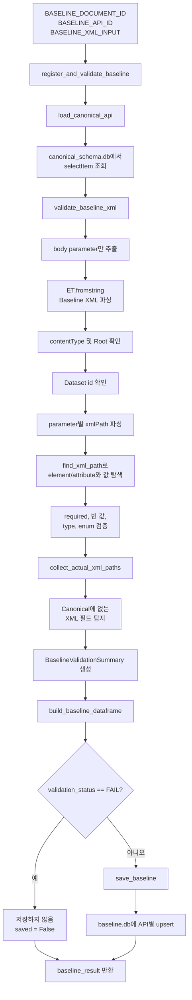

# Preprocessing Report

## 1. Swagger 기반 Canonical Schema 생성: `selectItem` 실행 흐름

이 항목은 [`preprocessing.ipynb`](./preprocessing.ipynb)의 1번 단계인 Swagger 기반 Canonical Schema 생성을 `selectItem` API를 예시로 정리한 것이다. 이 단계의 목적은 Swagger/OpenAPI의 operation과 request body schema를 API별로 동일한 형식의 Canonical Schema로 변환하고, 이후 XML Baseline 검증에서 재사용할 수 있도록 저장하는 것이다.

### 1.1 입력과 최종 산출물

- Swagger URL: `SWAGGER_URL`
- 문서 ID: `hmall-openapi-v1`
- 대상 operation: `POST /pd/pdb/selectItem.do`
- `operationId`: `selectItem`
- request content type: `application/xml`
- request body schema 참조: `#/components/schemas/selectItemRequest`

주요 산출물은 다음과 같다.

- 원본 Swagger: [`output/swagger_raw.json`](./output/swagger_raw.json)
- `selectItem`별 Canonical JSON: [`output/canonical_schema/hmall-openapi-v1/selectItem.json`](./output/canonical_schema/hmall-openapi-v1/selectItem.json)
- API별 Canonical Schema SQLite: [`output/canonical_schema.db`](./output/canonical_schema.db)
- 생성 결과 및 warning 리포트: [`output/canonical_schema_report.json`](./output/canonical_schema_report.json)

### 1.2 전체 실행 흐름



### 1.3 단계별 동작

#### 1) `fetch_swagger`: 원본 문서 조회

실행 셀은 먼저 Swagger URL을 호출한다.

```python
raw_swagger, fetch_meta = fetch_swagger(SWAGGER_URL)
```

`fetch_swagger`는 HTTP 요청을 보내 응답 JSON을 dictionary로 변환하고, HTTP status, content type, 응답 byte 수를 `fetch_meta`로 반환한다. 이 함수는 파일을 저장하지 않고 원본을 메모리로 반환한다.

실행 결과 리포트에는 다음 fetch 정보가 기록되어 있다.

```json
{
  "status": 200,
  "contentType": "application/json; charset=utf-8",
  "bytes": 237270
}
```

#### 2) `build_canonical_document`: 문서 전체 순회

```python
canonical_document = build_canonical_document(raw_swagger)
```

이 함수는 OpenAPI 버전과 `paths`를 확인한 뒤, 각 endpoint와 HTTP method를 순회한다. `selectItem`의 경우 다음 operation이 발견된다.

```text
POST /pd/pdb/selectItem.do
operationId = selectItem
```

문서 전체 순회는 `build_canonical_document`가 담당하고, operation 하나의 상세 변환은 `build_canonical_api`에 위임한다.

#### 3) `build_canonical_api`: `selectItem` API 변환

`operationId`가 있으므로 API ID는 그대로 `selectItem`이 된다. 이후 operation의 파라미터와 request body를 처리한다.

먼저 header parameter 두 개가 Canonical 경로로 변환된다.

```text
oauserId → $.headers.oauserId
oauseKey → $.headers.oauseKey
```

다음으로 request body의 content type과 schema를 확인한다.

```text
contentType = application/xml
schema     = #/components/schemas/selectItemRequest
```

body schema가 존재하므로 `walk_schema`가 `$.body`에서 시작된다.

#### 4) `$ref` 해석: `resolve_json_pointer`와 `resolve_schema`

request body의 시작점은 다음 `$ref`다.

```text
#/components/schemas/selectItemRequest
```

`resolve_json_pointer`는 Swagger 문서의 `components.schemas.selectItemRequest` 위치를 찾아 실제 schema 객체를 반환한다. `resolve_schema`는 이 과정을 감싸면서 `$ref`를 재귀적으로 해석하고, 필요한 경우 inline 속성을 병합한다.

해석된 schema의 주요 구조는 다음과 같다.

```text
Root
└─ Dataset (id = dsCond)
   └─ rows
      └─ row
         ├─ slitmCd
         ├─ itemCsfDCd
         └─ venCd
```

#### 5) `walk_schema`: request body 재귀 순회

`walk_schema`는 object를 만나면 `properties`를 따라 내부로 내려간다. object 자체는 parameter로 저장하지 않고, 실제 leaf field에 도달했을 때 `add_parameter`를 호출한다.

JSONPath는 다음처럼 생성된다.

```text
$.body.data1.id
$.body.data1.data2.data3.slitmCd
$.body.data1.data2.data3.itemCsfDCd
$.body.data1.data2.data3.venCd
```

동시에 XML metadata를 이용해 XMLPath도 만든다.

```text
/Root/Dataset[@id="dsCond"]/@id
/Root/Dataset[@id="dsCond"]/rows/row/slitmCd
/Root/Dataset[@id="dsCond"]/rows/row/itemCsfDCd
/Root/Dataset[@id="dsCond"]/rows/row/venCd
```

여기서 `Dataset[@id="dsCond"]`는 `get_xml_segment`가 생성하고, `@id`, `slitmCd` 같은 개별 segment 추가는 `append_xml_path`가 담당한다.

#### 6) `add_parameter`: Canonical parameter 생성

`add_parameter`는 leaf schema 하나를 `CanonicalParameter`로 변환해 목록에 추가한다. `selectItem`의 body field에는 다음 정보가 함께 저장된다.

- JSONPath: `path`
- 위치: `location = body`
- 필드명: `name`
- 정규화된 타입: `type = string`
- 원본 참조: `sourceRef = #/components/schemas/selectItemRequest`
- 설명과 예시: `description`, `example`
- XML 정보: `xmlName`, `xmlPath`, `xmlAttribute`

예를 들어 `slitmCd`는 다음과 같이 Canonical parameter가 된다.

```json
{
  "path": "$.body.data1.data2.data3.slitmCd",
  "location": "body",
  "name": "slitmCd",
  "type": "string",
  "description": "판매상품코드",
  "example": "판매상품코드(예:2015700001)",
  "sourceRef": "#/components/schemas/selectItemRequest",
  "xmlPath": "/Root/Dataset[@id=\"dsCond\"]/rows/row/slitmCd",
  "xmlAttribute": false
}
```

#### 7) `CanonicalApi`와 `CanonicalDocument` 완성

header 2개와 body 4개가 합쳐져 `selectItem` API에는 총 6개의 parameter가 들어간다.

```text
$.headers.oauserId
$.headers.oauseKey
$.body.data1.id
$.body.data1.data2.data3.slitmCd
$.body.data1.data2.data3.itemCsfDCd
$.body.data1.data2.data3.venCd
```

`build_canonical_api`는 이 목록과 API 메타데이터를 합쳐 `CanonicalApi`를 반환한다. 이후 `build_canonical_document`는 이를 전체 API 목록에 추가해 `CanonicalDocument`를 완성한다.

#### 8) `persist_results`: 최종 저장

```python
report = persist_results(
    raw_swagger,
    canonical_document,
    fetch_meta
)
```

마지막으로 `persist_results`가 다음 작업을 수행한다.

1. 원본 Swagger를 `swagger_raw.json`으로 저장
2. `selectItem.json`처럼 API별 Canonical JSON 저장
3. `api_canonical_schema` SQLite 테이블에 API별 JSON upsert
4. source hash, API 수, parameter 수, warning 수를 품질 리포트에 저장

이렇게 생성된 `selectItem` Canonical Schema는 이후 Baseline 등록 단계에서 SQLite로 조회된다. 이후 XML 검증은 `xmlPath`, `xmlAttribute`, `required`, `type` 등의 정보를 이용해 실제 Baseline XML과 Canonical Schema의 구조와 값을 비교한다.

## 2. Baseline 등록 및 검증: `selectItem` 실행 흐름

이 항목은 [`preprocessing.ipynb`](./preprocessing.ipynb)의 2번 단계인 Baseline 등록 및 검증을 `selectItem` API를 예시로 정리한 것이다. 1번 단계에서 생성한 Canonical Schema를 SQLite에서 조회하고, 실제 request XML body가 Canonical Schema의 XML 구조와 필드 정의에 맞는지 검증한 뒤, 검증을 통과한 Baseline을 `baseline.db`에 저장한다.

### 2.1 입력과 최종 산출물

- 문서 ID: `hmall-openapi-v1`
- 대상 API ID: `selectItem`
- Canonical Schema 입력: [`output/canonical_schema.db`](./output/canonical_schema.db)의 `api_canonical_schema` 테이블
- Baseline XML 입력: `BASELINE_XML_INPUT`
- request content type: `application/xml`

`selectItem`에 사용하는 Baseline XML은 다음과 같다.

```xml
<?xml version="1.0" encoding="UTF-8"?>
<Root>
    <Dataset id="dsCond">
        <rows>
            <row>
                <slitmCd>2015700001</slitmCd>
                <itemCsfDCd>40010202</itemCsfDCd>
                <venCd>003766</venCd>
            </row>
        </rows>
    </Dataset>
</Root>
```

이 XML은 `selectItem` Canonical Schema의 다음 body 경로와 매칭된다.

```text
/Root/Dataset[@id="dsCond"]/@id
/Root/Dataset[@id="dsCond"]/rows/row/slitmCd
/Root/Dataset[@id="dsCond"]/rows/row/itemCsfDCd
/Root/Dataset[@id="dsCond"]/rows/row/venCd
```

주요 산출물은 다음과 같다.

- 검증 결과 요약: `baseline_result['summary']`
- 필드별 검증 결과: `baseline_result['rows']`
- 검증 결과 DataFrame: `baseline_result['dataframe']`
- 저장 여부: `baseline_result['saved']`
- Baseline SQLite: [`output/baseline.db`](./output/baseline.db)의 `api_baseline` 테이블

### 2.2 전체 실행 흐름



### 2.3 단계별 동작

#### 1) 입력값 설정 및 실행

마지막 셀에서 문서 ID, API ID, XML body를 설정한다.

```python
BASELINE_DOCUMENT_ID = DOCUMENT_ID
BASELINE_API_ID = 'selectItem'
BASELINE_XML_INPUT = """<?xml version="1.0" encoding="UTF-8"?>
<Root>
    <Dataset id="dsCond">
        <rows>
            <row>
                <slitmCd>2015700001</slitmCd>
                <itemCsfDCd>40010202</itemCsfDCd>
                <venCd>003766</venCd>
            </row>
        </rows>
    </Dataset>
</Root>"""
```

이후 다음 함수를 실행한다.

```python
baseline_result = register_and_validate_baseline(
    document_id=BASELINE_DOCUMENT_ID,
    api_id=BASELINE_API_ID,
    baseline_xml=BASELINE_XML_INPUT,
)
```

여기서 입력하는 값은 HTTP header나 URL이 아니라 request body XML 전문이다. `selectItem`의 header parameter인 `oauserId`, `oauseKey`는 Canonical Schema에 포함되어 있지만, 현재 Baseline 검증 함수는 `location == 'body'`인 parameter만 검증한다.

#### 2) `load_canonical_api`: Canonical Schema 조회

```python
canonical_api = load_canonical_api(
    document_id='hmall-openapi-v1',
    api_id='selectItem',
)
```

`load_canonical_api`는 `canonical_schema.db`의 `api_canonical_schema` 테이블에서 `(document_id, api_id)`를 조건으로 `canonical_json`을 조회한다. `selectItem`에 대해 조회되는 body parameter는 다음 네 개다.

```text
$.body.data1.id                     → /Root/Dataset[@id="dsCond"]/@id
$.body.data1.data2.data3.slitmCd    → /Root/Dataset[@id="dsCond"]/rows/row/slitmCd
$.body.data1.data2.data3.itemCsfDCd → /Root/Dataset[@id="dsCond"]/rows/row/itemCsfDCd
$.body.data1.data2.data3.venCd      → /Root/Dataset[@id="dsCond"]/rows/row/venCd
```

이 단계에서 API를 찾지 못하거나 `canonical_json`이 올바른 JSON object가 아니면 검증 전에 예외가 발생한다.

#### 3) `validate_baseline_xml`: XML 기본 구조 확인

검증 함수는 먼저 Canonical API의 parameter 중 `location == 'body'`인 항목만 추출한다. 이후 다음 기본 검사를 수행한다.

1. XML body가 비어 있지 않은지 확인
2. `ET.fromstring`으로 XML 문법 확인
3. Canonical content type이 `application/xml`인지 확인
4. XML root가 Canonical Schema의 첫 XML 경로인 `Root`와 일치하는지 확인
5. XML에 존재하는 Dataset ID가 Canonical Schema에 정의되어 있는지 확인

`selectItem`에서는 다음 값이 서로 일치해야 한다.

```text
Canonical Dataset id: dsCond
Baseline Dataset id:  dsCond
```

#### 4) `parse_xml_path`와 `find_xml_path`: Canonical 경로 기반 값 탐색

각 Canonical parameter의 `xmlPath`를 segment 목록으로 나누고, Baseline XML에서 해당 경로를 찾는다. 예를 들어 `slitmCd`의 경로는 다음과 같이 해석된다.

```text
/Root/Dataset[@id="dsCond"]/rows/row/slitmCd
```

```text
Root
└─ Dataset[@id="dsCond"]
   └─ rows
      └─ row
         └─ slitmCd → 2015700001
```

`find_xml_path`의 반환 결과는 element와 attribute를 구분한다.

```python
# element 예시
{
    'kind': 'element',
    'element': <slitmCd>2015700001</slitmCd>,
    'value': '2015700001',
}

# attribute 예시
{
    'kind': 'attribute',
    'element': <Dataset id="dsCond">,
    'value': 'dsCond',
}
```

따라서 `selectItem`의 실제 추출값은 다음과 같다.

```text
id         = dsCond
slitmCd    = 2015700001
itemCsfDCd = 40010202
venCd      = 003766
```

#### 5) 필드별 검증

경로에서 값을 찾은 뒤 `validate_baseline_xml`은 각 필드에 대해 다음 항목을 확인한다.

- Canonical 경로가 XML에 존재하는지 확인
- required 필드가 누락되거나 빈 값인지 확인
- `integer`, `number` 타입인 경우 숫자 변환 가능 여부 확인
- enum 목록이 있는 경우 허용 값인지 확인
- 선택 필드가 비어 있는 경우 메시지만 기록

`selectItem`의 body field는 모두 `string` 타입이고 enum도 없으므로, 이 입력에서는 값의 존재 여부와 XML 경로 일치 여부가 핵심 검증 대상이다.

필드별 결과 row에는 다음 정보가 기록된다.

```text
path, xmlPath, name, expected_type, required,
expected_value, actual_value, xmlAttribute, status, message
```

#### 6) `collect_actual_xml_paths`: 미등록 XML 필드 확인

parameter별 검증이 끝나면 `collect_actual_xml_paths`가 Baseline XML의 leaf element와 attribute 경로를 모두 수집한다. Canonical Schema의 `xmlPath` 목록에 없는 실제 경로가 있으면 `UNKNOWN_FIELD`로 기록한다.

`selectItem`의 입력 XML은 다음 경로만 포함하므로, 모두 Canonical Schema와 일치한다.

```text
/Root/Dataset[@id="dsCond"]/@id
/Root/Dataset[@id="dsCond"]/rows/row/slitmCd
/Root/Dataset[@id="dsCond"]/rows/row/itemCsfDCd
/Root/Dataset[@id="dsCond"]/rows/row/venCd
```

#### 7) 검증 요약 생성

각 row의 상태를 집계하여 최종 상태를 결정한다.

```text
PASS                   : 오류 없음
PASS_WITH_REQUIRED_EMPTY: required 빈 값만 존재
FAIL                   : 구조, 누락, 타입, enum, unknown field 오류 존재
```

정상적인 `selectItem` 입력이라면 다음과 같은 결과가 된다.

```json
{
  "document_id": "hmall-openapi-v1",
  "api_id": "selectItem",
  "validation_status": "PASS",
  "total_fields": 4,
  "valid_count": 4,
  "required_empty_count": 0,
  "error_count": 0,
  "unknown_field_count": 0
}
```

#### 8) `build_baseline_dataframe`: 결과 표시

`build_baseline_dataframe`은 검증 row 목록을 pandas DataFrame으로 변환한다. Jupyter 환경에서는 `display(dataframe)`으로 표를 출력하고, `display`가 없는 환경에서는 문자열 표로 출력한다.

`baseline_result['dataframe']`을 통해 필드별 실제 값과 상태를 다시 확인할 수 있다.

#### 9) `save_baseline`: `baseline.db` 저장

검증 상태가 `FAIL`이 아니면 `save_baseline`이 `output/baseline.db`의 `api_baseline` 테이블에 Baseline을 저장한다.

저장 항목은 다음과 같다.

- `document_id`: `hmall-openapi-v1`
- `api_id`: `selectItem`
- `baseline_xml`: 입력 XML 전문
- `content_type`: `application/xml`
- `validation_status`: `PASS` 또는 `PASS_WITH_REQUIRED_EMPTY`
- `validation_result_json`: 전체 검증 결과
- `created_at`, `updated_at`: 저장 시각

`(document_id, api_id)`가 복합 기본키이므로 동일한 `selectItem` Baseline을 다시 실행하면 중복 row가 생성되지 않고 기존 row가 갱신된다. Canonical Schema 생성 단계의 `api_canonical_schema` 저장도 같은 방식의 upsert이므로, Canonical Schema를 재생성한 뒤 Baseline 검증을 다시 수행할 수 있다.

#### 10) `register_and_validate_baseline`: 전체 오케스트레이션

최상위 함수인 `register_and_validate_baseline`은 앞의 과정을 순서대로 연결한다.

```text
Canonical Schema 조회
→ XML 검증
→ DataFrame 변환 및 표시
→ FAIL이 아니면 baseline.db 저장
→ summary, rows, dataframe, saved 반환
```

따라서 `selectItem`의 XML이 Canonical Schema와 일치하면 `baseline_result['saved']`는 `True`가 되고, 구조 오류나 `UNKNOWN_FIELD`가 있으면 `False`가 되며 `baseline.db`에는 저장되지 않는다.
